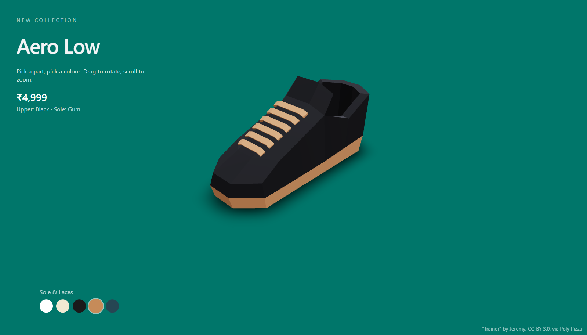

# Aero Low: 3D Product Viewer

A 3D sneaker customiser built with React Three Fiber. Click a part of the shoe, pick a colour, and save an image of your design.

**Live demo:** https://3d-product-viewer-green.vercel.app/

## Features

- Interactive 3D model with orbit, zoom and idle auto-rotate (pauses while you edit)
- Click the upper or sole to choose which part to recolour
- Smooth colour transitions and a hover glow on parts
- Background colour picker
- "Save image" exports your design as a PNG, named after your colour choices
- Loading screen and entrance animation
- Responsive camera and touch-friendly controls for phones

## Tech

React, Vite, Three.js, @react-three/fiber, @react-three/drei, Tailwind CSS. Deployed on Vercel.

## Run locally

    npm install
    npm run dev

## What I learned

- Structuring a 3D scene as React components, and sharing state between the canvas and the HTML UI
- Per-frame animation with `useFrame`, easing and damped colour transitions
- Pointer events, raycasting and mapping meshes to UI state
- Capturing a WebGL canvas to an image
- Responsive camera handling and performance tuning for mobile

## Credits

Model: "Trainer" by Jeremy, licensed under [CC-BY 3.0](https://creativecommons.org/licenses/by/3.0/), via [Poly Pizza](https://poly.pizza/m/cs7k_ENAZjQ). Colours modified.
